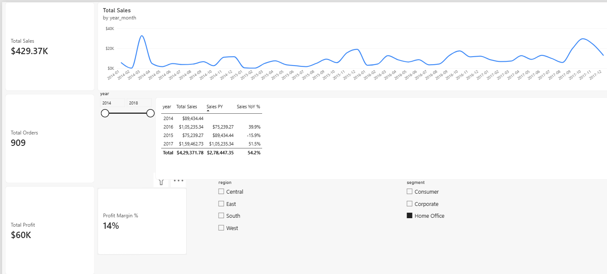
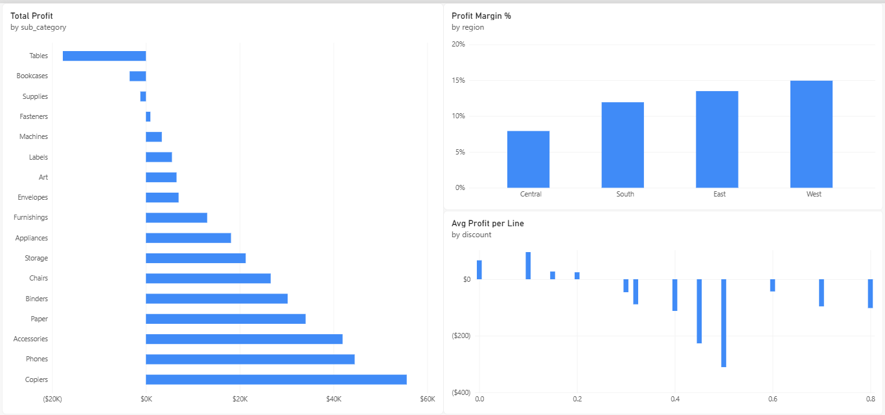

# Sales KPI Dashboard (PostgreSQL + Power BI)

Interactive sales dashboard built on a **star schema in PostgreSQL** and **Power BI with DAX measures**. It answers *"How is the business performing, and where do we lose money?"*



## Problem / Goal
Managers need one place to track sales, profit and margin over time, and to drill into regions, segments and product categories without asking an analyst every time.

## Tech Stack
- **PostgreSQL**: star schema built with SQL views (`sql/01_star_schema_views.sql`)
- **Power BI Desktop**: data model, relationships, report design
- **DAX**: KPI and time-intelligence measures

## Data Model (Star Schema)
```
            dim_customer
                 |
dim_product — fact_sales — dim_location
                 |
             dim_date
```
| Table | Rows | Content |
|---|---|---|
| fact_sales | 9,993 | order lines: sales, quantity, discount, profit (duplicate removed via `ROW_NUMBER()`) |
| dim_customer | 793 | customer, segment |
| dim_product | 1,862 | product, category, sub-category |
| dim_location | 631 | city, state, region |
| dim_date | 1,464 | calendar (year, quarter, month), marked as date table |

## DAX Measures
| Measure | Formula idea |
|---|---|
| Total Sales / Total Profit | `SUM` |
| Profit Margin % | `DIVIDE(profit, sales)`, safe against division by zero |
| Total Orders | `DISTINCTCOUNT(order_id)`, since one order has several lines |
| Sales PY | `CALCULATE` + `SAMEPERIODLASTYEAR` (blank when no current sales) |
| Sales YoY % | growth vs. previous year |
| Sales YTD | `TOTALYTD` running total |
| Avg Profit per Line | `AVERAGE(profit)` |

## Dashboard Pages
**1. Overview:** KPI cards (Sales ≈ $2.30M, Profit ≈ $286K, Margin ≈ 12.5%, ≈ 5,000 orders), monthly trend, YoY table, slicers for year, region and segment.

**2. Profitability:** profit by sub-category, average profit by discount level, margin by region, category slicer.



## Key Insights
1. **Tables, Bookcases and Supplies** are loss-making sub-categories.
2. **Discounts of 30% and more** make the average order line unprofitable.
3. **West** has the best margin, **Central** the weakest.
4. **Furniture in the Central region has a negative margin**, a combination only visible by filtering both dimensions.
5. Sales dipped slightly in 2015, then grew strongly in 2016 and 2017.

## How to Run
1. Load the data into PostgreSQL (see [sales-data-analysis](https://github.com/Akshay-tr58/sales-data-analysis))
2. Create the star schema:
   ```bash
   psql -U postgres -d superstore -f sql/01_star_schema_views.sql
   ```
3. Open `sales_kpi_dashboard.pbix` in Power BI Desktop → **Refresh** (server `localhost`, database `superstore`)

## What I Learned
- Designing a **star schema** with SQL views (`ROW_NUMBER`, `DISTINCT ON`, `generate_series`)
- Setting up **relationships** (many-to-one, single direction) and a **date table**
- **Time intelligence** in DAX and handling edge cases (fake −100% growth in a year without sales)

## Next Steps
- Automate a weekly PDF/Excel report from the same views (Python)
- Add a customer analysis page (top customers, segment comparison)

---

### Kurzbeschreibung (Deutsch)
Interaktives Vertriebs-Dashboard in Power BI auf Basis eines Sternschemas in PostgreSQL (SQL-Views). Enthält DAX-Kennzahlen für Umsatz, Gewinn, Marge und Vorjahresvergleich. Die Analyse zeigt u. a., dass Möbel in der Region Central mit Verlust verkauft werden.